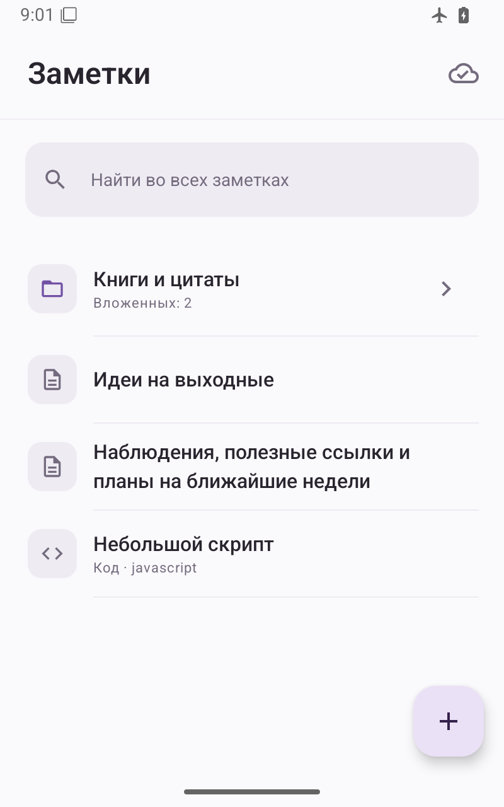
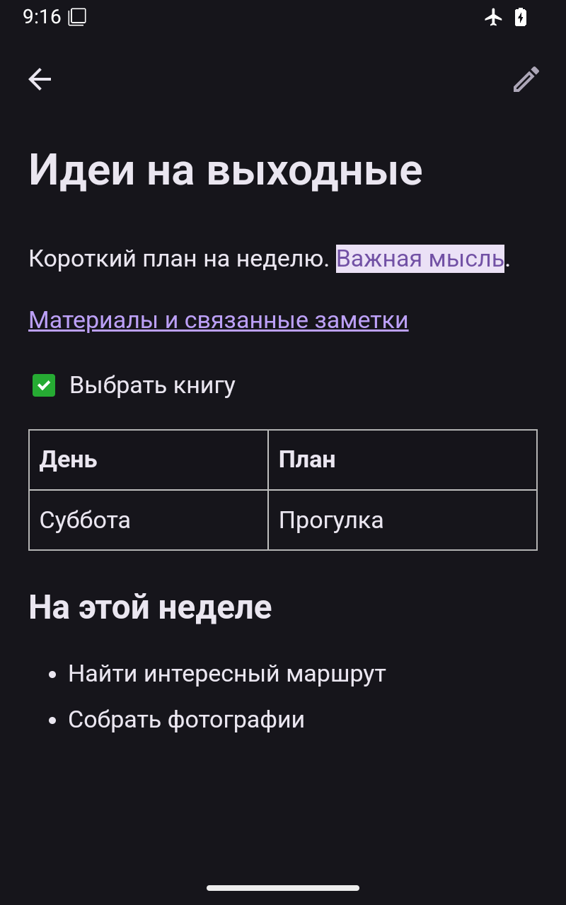

# trilium-client

An independent Android client for [Trilium Notes](https://github.com/TriliumNext/Trilium), using its ETAPI. Native Jetpack Compose navigation surrounds a bundled WebView editor for HTML and Markdown. The app connects to your existing Trilium server; it does not run a server on the phone.

This is a source-release preview of version **0.3.5**, intended for people comfortable building Android apps. Connection settings are supplied at build time. There is no runtime server setup or account screen yet, and the demo build is a disconnected UI build, not a ready-to-use Trilium client.

## Features

- Browse the note tree, including clones, and search titles and content.
- Create and edit HTML, Markdown and source notes. The bundled CKEditor provides visual editing; Markdown stays Markdown when saved.
- Download visible notes and attachments for offline reading, editing and search. Local drafts survive restarts and sync when connectivity returns.
- Queue deletions offline, with confirmation and retries. Deleting a note removes its clones; descendants with another parent remain available. There is no undo in the client.
- Preview images, PDF, audio, video and text attachments; save, share or open files with Android apps.
- Follow internal note links, use system light/dark themes and return to the previous position in folders and search results.

Initial offline download needs a connection. Android schedules background work and may delay it. Conflict handling preserves local edits, but ETAPI has no atomic conditional write, so simultaneous edits from multiple clients still have a race between the version check and save.

Canvas, relation maps, encrypted notes and server widgets do not have full native support. Unsupported special notes show an explanation and an option to open Trilium; encrypted notes must be unlocked there. Mermaid is edited as source. Server commands and widgets are not executed by this client.

## Screenshots

All screenshots use synthetic notes.

| Library | Editor |
| --- | --- |
|  |  |

More examples: [Markdown](docs/screenshots/markdown-reader.png), [offline library](docs/screenshots/offline-list-light.png), [sync details](docs/screenshots/sync-details.png), [delete confirmation](docs/screenshots/delete-confirmation-dark.png).

## Build

Requires **JDK 17**, **Android SDK 36** and the included Gradle wrapper. The app supports **Android 9 or newer** (API 28) and targets API 36. Set `ANDROID_HOME` or create an ignored `local.properties` with `sdk.dir` pointing to your SDK.

For a disconnected build with dummy credentials:

```sh
./gradlew -PdemoBuild=true :app:assembleDebug
```

`-PdemoBuild=true` ignores both `private.properties` and `signing.properties`. With no private configuration, builds also default to `https://trilium.invalid` and a dummy token. This does not include a sample server or a populated sample library; the screenshots show separate synthetic test data.

For a build connected to your own server:

```sh
cp private.properties.example private.properties
chmod 600 private.properties
# Set trilium.baseUrl and trilium.token in private.properties.
./gradlew :app:assembleDebug
```

Use your server's ETAPI token and HTTPS address. **The configured URL and token are compiled into the APK. Keep connected APKs private:** anyone who receives one can extract those credentials. The ignored configuration files are local to your checkout; do not commit them.

To sign your own release, copy `signing.properties.example` to `signing.properties` and configure your own PKCS#12 key. Then run `./gradlew :app:assembleRelease`. Without signing configuration, release output is unsigned. Keep the same key for future updates if you want to retain installed app data. The existing application ID is retained for update compatibility; changing the repository name does not change the installed package.

## Validation and contributing

See the [validation record](docs/acceptance.md) for the tested scope and known gaps, and [CONTRIBUTING.md](CONTRIBUTING.md) for local checks. [Android CI](.github/workflows/build.yml) builds and tests with dummy connection settings.

## License

Project code is licensed under [GPL-3.0-or-later](LICENSE). Bundled dependencies retain their own notices and licenses; see [THIRD_PARTY_NOTICES.md](THIRD_PARTY_NOTICES.md) and the editor vendor [notice](app/src/main/assets/editor/vendor/NOTICE.txt).
